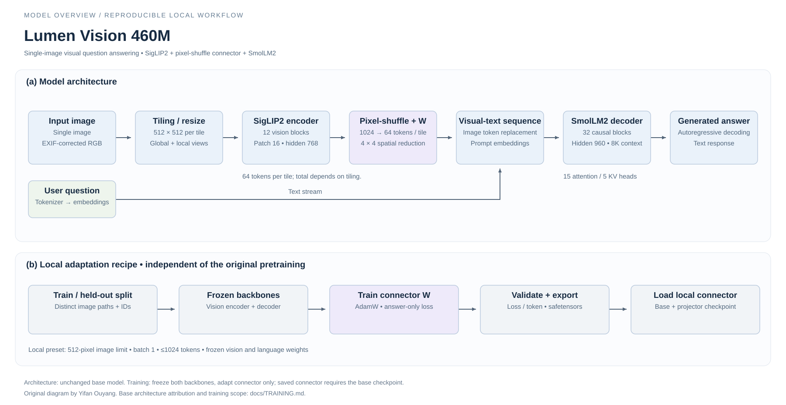

# Lumen Vision 460M



A compact single-image VLM with a practical local workflow: **folder → answers → JSONL + standalone HTML report**. English image questions and document experiments; about 460M parameters and 2.03 GB of unchanged weights.

[Weights](https://huggingface.co/yifanouyang/Lumen-Vision-460M) · [Local install / offline guide](docs/LOCAL.md) · [Training scope](docs/TRAINING.md) · [Fixes & checks](docs/CHANGES.md)

## Run locally

Python 3.11+, a virtual environment, CPU or CUDA:

```bash
pip install -r requirements.txt
python scripts/ask_image.py --doctor
python scripts/ask_image.py --image photo.jpg --device cpu
python scripts/ask_image.py --folder photos --output runs/results.jsonl --html runs/report.html
```

The CLI pins the weight revision, uses the local reviewed implementation, corrects image orientation, and rejects truncated image-token mismatches. No paid API is required. Download the complete checkpoint for offline use; see the short [guide](docs/LOCAL.md).

## Scope & credit

Maintained by Yifan Ouyang, based on [Tether AI Research / VisionPsy Nano](https://github.com/tether-ai-research/qvac-visionpsy-nano), Apache-2.0. This release adds deployment tools and bug fixes; it does not claim new training or reproduced accuracy. Original authors report ScienceQA 86.5, MMStar 47.6 and POPE F1 87.9; see the [source model card](https://huggingface.co/qvac/VisionPsy-Nano-460M).

English-first and single-image; hallucinations and counting errors remain possible. Original license and [provenance](docs/PROVENANCE.json) are preserved. Detailed upstream runtime guides remain in `hf-inference/`, `vllm-inference/` and `llama-cpp-inference/`.
