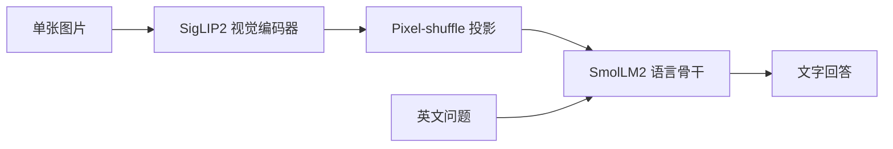

# Lumen Vision 460M

轻量视觉语言模型的部署整理版：输入一张图片和问题，输出文字回答。适合看图问答、英文文档与图表阅读实验。

**[下载完整权重](https://huggingface.co/yifanouyang/Lumen-Vision-460M/tree/main)** · [模型卡](https://huggingface.co/yifanouyang/Lumen-Vision-460M) · [上游完整指南](docs/UPSTREAM_README.md)

[单文件权重直链](https://huggingface.co/yifanouyang/Lumen-Vision-460M/resolve/main/model.safetensors)（运行时还需配置、分词器和模型代码，建议完整下载）。

约 460M 参数，float32 权重约 2.03 GB。主要支持英文，单图输入；不是通用多图助手。首次运行下载模型，缓存后可离线使用。

## 快速开始

Python 3.10+，CPU 可运行，CUDA GPU 更快。先安装依赖，再用自己的图片提问：

```bash
pip install -r hf-inference/requirements.txt
python scripts/ask_image.py --image your_image.jpg --prompt "Describe this image."
```

完整下载到本地：

```bash
hf download yifanouyang/Lumen-Vision-460M --local-dir checkpoints/lumen-vision
python scripts/ask_image.py --model checkpoints/lumen-vision --image your_image.jpg
```

模型使用自定义 Transformers 实现，加载会执行模型仓库中的 Python 代码（`trust_remote_code=True`）。生产环境应审阅代码并固定模型 revision。

## 目录导航

| 目录 | 用途 |
| --- | --- |
| `scripts/` | Lumen 统一入口，默认下载本账号权重 |
| `hf-inference/` | Transformers 参考实现 |
| `vllm-inference/` | CUDA 服务部署 |
| `llama-cpp-inference/` | 上游量化运行时；GGUF 权重需另行获取 |
| `docs/` | 原始文档、来源和发布记录 |



## 结果与验证

以下是原模型作者报告的指标，**本项目没有重新训练，也未复测这些指标**。完整评测配置与限制见[原始模型卡](https://huggingface.co/qvac/VisionPsy-Nano-460M)。

| 基准 | 指标 | 上游报告 |
| --- | --- | --- |
| ScienceQA | Accuracy | 86.5 |
| MMStar | Accuracy | 47.6 |
| POPE | F1 | 87.9 |

本次发布检查源码语法、入口路径及 Hub 权重对象一致性；没有运行完整推理或 GPU 基准。小模型可能幻觉、误读与误计数，不建议用于自动高风险决策。

## 来源与许可

Lumen 是 Yifan Ouyang 维护的部署整理与权重镜像名称。模型与核心代码来自 [Tether AI Research / VisionPsy Nano](https://github.com/tether-ai-research/qvac-visionpsy-nano)，权重为原文件镜像，没有声称自行训练。保留 Apache 2.0 许可、上游名称及归属；兼容原权重的类名保持不变。详见 [来源记录](docs/PROVENANCE.json)。

上游模型卡与训练数据归属保留在 Hugging Face 的 `UPSTREAM_MODEL_CARD.md` 和 `ATTRIBUTIONS.md` 中；不同训练数据可能有各自许可。本项目不重新分发训练数据，也不作额外的商用保证。
